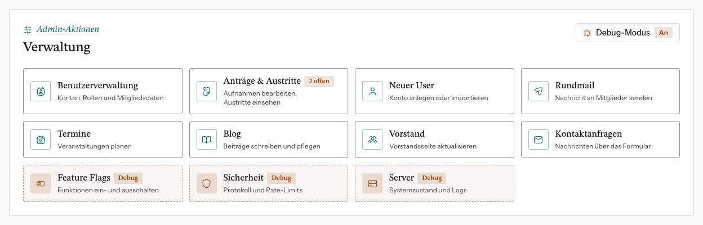

# Der Admin-Bereich im Überblick

Nach dem Login landest du auf dem **Dashboard**. Admins sehen dort zusätzlich
die Karte **Verwaltung** mit allen Werkzeugen.

| Kachel | Wofür |
|---|---|
| Benutzerverwaltung | alle Konten, Mitgliedsdaten und Beiträge |
| Anträge & Austritte | Aufnahmeanträge entscheiden, Austritte einsehen; der Badge zeigt offene Anträge |
| Neuer User | ein Konto von Hand anlegen |
| Rundmail | Mails an Gruppen oder einzelne Personen |
| Termine | Veranstaltungen anlegen und ankündigen |
| Blog | Beiträge schreiben, Bilder hochladen |
| Vorstand | die Seite `/vorstand` und die Signatur |
| Kontaktanfragen | Nachrichten aus dem Kontaktformular |
| Feature Flags, Sicherheit, Server | Technik; nur im [Debug-Modus](debug-modus.md) sichtbar |

## Rollen

- **Administrator**: sieht und darf alles oben Genannte.
- **Mitglied**: sieht nur das eigene Profil, die eigenen Beiträge und den
  Alumni-Kosmos.

Die Rolle ist unabhängig vom Mitgliedsstatus. Ein Admin ist meistens auch
ordentliches Mitglied, das muss aber nicht so sein. Rollen vergibst du in
[Konto bearbeiten](../02-konten/konto-bearbeiten.md).

## Gut zu wissen

- **Admin-Sitzungen enden spätestens 12 Stunden nach dem Login.** Danach
  meldest du dich neu an, auch wenn du die ganze Zeit aktiv warst.
- **Admins können sich immer einloggen**, auch wenn das Feature Flag „Login“
  aus ist. So sperrst du dich nicht selbst aus.
- Ist eine Funktion per Feature Flag abgeschaltet, erscheint beim Versuch, sie
  zu nutzen, ein Hinweisdialog statt eines Fehlers.
