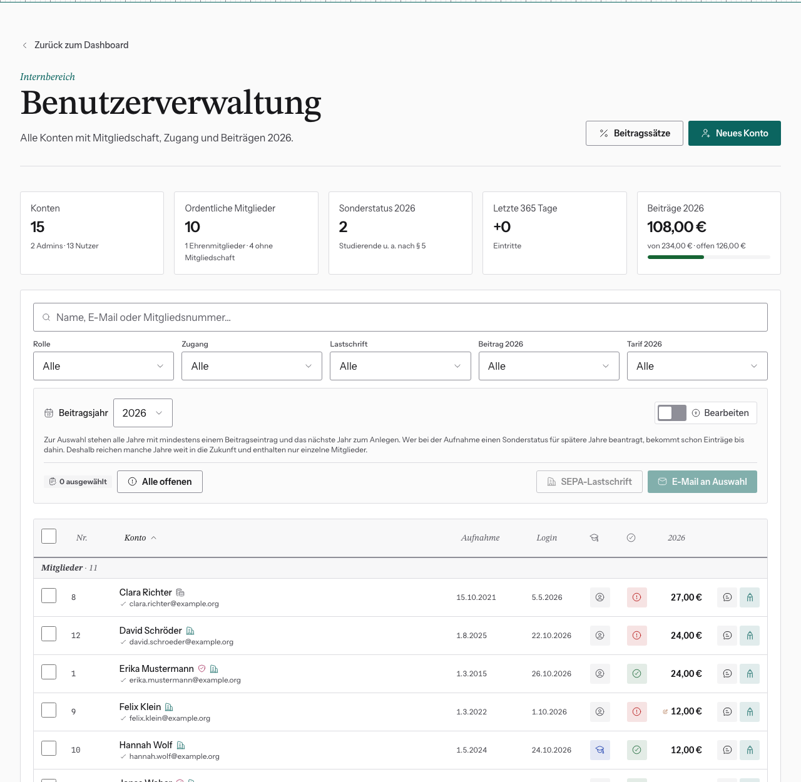

# Benutzerverwaltung: Liste, Suche, Filter

Dashboard → **Benutzerverwaltung** (`/dashboard/users`). Hier steht jedes
Konto genau einmal, mit Mitgliedschaft, Zugang und Beitrag des gewählten Jahres.

## Oben: Kennzahlen

- **Konten**: alle Konten, davon Admins
- **Ordentliche Mitglieder**: darunter Ehrenmitglieder und Konten ohne
  Mitgliedschaft
- **Sonderstatus**: Mitglieder mit ermäßigtem Beitrag (§ 5) im gewählten Jahr
- **Letzte 365 Tage**: Eintritte. Ausgetretene zählen hier nicht, ihre Konten
  verschwinden.
- **Beiträge**: bezahlt / fällig / offen im gewählten Jahr. Es zählen nur
  angelegte Beitragseinträge.

## Beitragsjahr wählen

Über **Beitragsjahr** oberhalb der Tabelle wählst du, welches Jahr Tabelle,
Kennzahlen und Filter zeigen. Zur Auswahl stehen alle Jahre mit mindestens einem
Beitragseintrag und das nächste Jahr zum Anlegen, siehe
[Neues Beitragsjahr anlegen](../04-beitraege/beitragsjahr-anlegen.md).

- **Vergangene Jahre** zeigen nur Konten, die damals Mitglied waren. Wie viele
  ausgeblendet sind, steht über der Tabelle.
- Hat jemand für das Jahr noch **keinen Beitragseintrag**, stehen in den
  Spalten Tarif, Zahlung und Betrag nur „—“.

## Suchen und filtern

Das Suchfeld findet Name, E-Mail oder Mitgliedsnummer. Darunter filterst du
nach **Rolle**, **Zugang** (aktiv, Login gesperrt, E-Mail unbestätigt),
**Lastschrift**, **Beitrag** (offen/bezahlt) und **Tarif** (Sonderstatus/regulär).

Die Filter stehen in der Adresszeile. Du kannst den Link also speichern oder
weitergeben, und nach dem Zurückkommen aus einem Profil sind sie noch gesetzt.

## Die Tabelle

Die Konten sind in drei Gruppen getrennt: **Mitglieder**, **Ehrenmitglieder**
und **Keine Mitglieder**. Ein Klick auf eine Spaltenüberschrift sortiert
innerhalb der Gruppen.

Die Symbole erklärt die Legende unter der Tabelle. Die wichtigsten:

| Symbol am Namen | Bedeutung |
|---|---|
| Bankgebäude | zahlt per SEPA-Lastschrift |
| Münzen | ohne Lastschrift, Beitrag mit 10 % Aufschlag |
| Schild | Administrator |
| durchgestrichene Person | Login gesperrt |
| „ausgetreten“ | im Beitragsjahr ausgetreten |
| rotes ✗ an der E-Mail | Adresse noch nicht bestätigt |

Pro Zeile kannst du außerdem:

- **auf den Namen klicken**, um den Beitragsverlauf aller Jahre zu öffnen
- auf **die E-Mail** klicken, um eine Mail an diese Person zu schreiben
- über die **Sprechblase** eine interne Notiz anlegen. Das ist derselbe Text
  wie „Interner Vermerk“ im Profil.
- über den **Knopf ganz rechts** („Profil bearbeiten“) das Profil öffnen, siehe
  [Konto bearbeiten](konto-bearbeiten.md)

Zahlungen, Tarif und Beträge änderst du ebenfalls hier, siehe
[Zahlungen und Ausnahmen pflegen](../04-beitraege/beitraege-pflegen.md).

## Mehrere Konten auswählen

Über die Kästchen links wählst du Konten aus. **Alle offenen** wählt alle
sichtbaren Konten mit offenem Beitrag. Mit der Auswahl kannst du dann:

- **E-Mail an Auswahl** schicken
- eine **SEPA-Lastschrift** erzeugen

Es zählt nur, was gerade sichtbar ist: Was ein Filter ausblendet, bekommt keine
Mail und landet in keiner SEPA-Datei.
