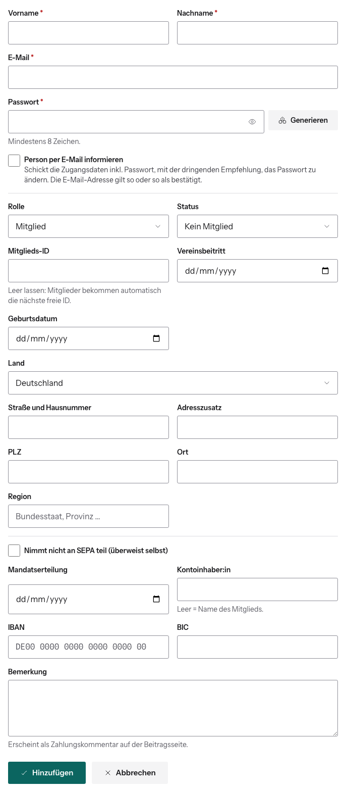

# Konto von Hand anlegen

Normalerweise registrieren sich Leute selbst unter `/mitglied-werden` und
stellen dort ihren Antrag. Von Hand legst du ein Konto nur an, wenn das nicht
geht, z. B. für jemanden, der sich auf Papier angemeldet hat.

> **Massenimport:** Auf derselben Seite gibt es unten den Bereich „Alumni
> importieren“. Der war nur für die einmalige Übernahme der Altdaten gedacht und
> ist seit 10/2026 erledigt. **Du brauchst ihn nicht mehr.**

## So geht's

1. Dashboard → **Neuer User** (oder in der Benutzerverwaltung **Neues Konto**).
2. Fülle **Vorname**, **Nachname**, **E-Mail** und **Passwort** aus.
   **Generieren** erzeugt ein sicheres Passwort.
3. Optional **Person per E-Mail informieren**: Die Person bekommt ihre
   Zugangsdaten samt Passwort und die Bitte, es zu ändern. Ohne Haken musst du
   ihr das Passwort selbst mitteilen.
4. Wähle **Rolle** und **Status**.
5. Bei Mitgliedern:
   - **Mitglieds-ID** leer lassen, dann wird die nächste freie vergeben.
   - **Vereinsbeitritt** eintragen: Ab diesem Jahr werden Beiträge angelegt.
   - Bankdaten eintragen, oder **Nimmt nicht an SEPA teil** anhaken.
   - Optional **Alle Beiträge bezahlt**: setzt alle Jahre vom Eintritt bis
     heute auf bezahlt.
   - Optional die **Jahre mit ermäßigtem Beitrag** anhaken.
6. **Hinzufügen**.

## Was dabei passiert

- Die E-Mail-Adresse gilt sofort als bestätigt.
- Von Admins angelegte Konten werden nie automatisch gelöscht, auch wenn sich
  niemand einloggt.
- Für Mitglieder entstehen Beitragszeilen vom Eintrittsjahr bis zum laufenden
  Jahr, berechnet nach den [Beitragssätzen](../04-beitraege/beitragssaetze.md).
- **Bemerkung** landet als interne Notiz am Konto.

Abschalten lässt sich das Anlegen über das Feature Flag „Nutzer anlegen“.
