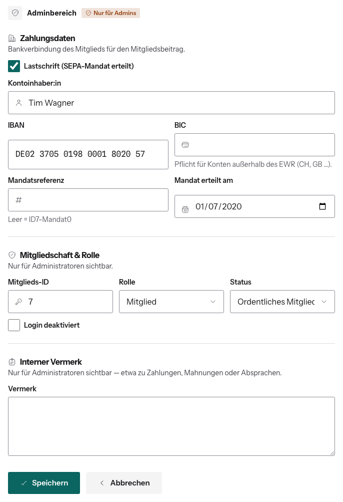

# Konto bearbeiten

Benutzerverwaltung → Knopf **Profil bearbeiten** ganz rechts in der Zeile. Du siehst dieselbe Seite wie das Mitglied selbst, nur mit
einem zusätzlichen **Adminbereich** am Ende.

## Persönliche Daten, Adresse, Studium, Beruf

Wie im Profil des Mitglieds. Änderst du die **E-Mail-Adresse** eines anderen
Kontos, gilt sie sofort, ohne Bestätigungslink. Noch offene Bestätigungs- und
Passwort-Links an die alte Adresse werden dabei ungültig.

## Adminbereich

**Zahlungsdaten**
- **Lastschrift (SEPA-Mandat erteilt)**: ohne Haken zahlt das Mitglied
  10 % Aufschlag und taucht in keiner SEPA-Datei auf.
- **Kontoinhaber:in**, **IBAN**, **BIC** (BIC nur außerhalb des EWR nötig,
  z. B. CH, GB).
- **Mandatsreferenz**: leer lassen, dann gilt die angezeigte Standardreferenz
  (z. B. `ID7-Mandat0`). Nur ändern, wenn eine andere Referenz bei der Bank
  hinterlegt ist.
- **Mandat erteilt am**: Datum der Unterschrift.

**Mitgliedschaft & Rolle**
- **Mitglieds-ID**: muss eindeutig sein.
- **Rolle**: Mitglied oder Administrator.
- **Status**: Ordentliches Mitglied, Ehrenmitglied oder Kein Mitglied. Wenn du
  jemanden auf „Kein Mitglied“ stellst, ist das ein Austritt, siehe
  [Mitgliedschaft beenden](../03-aufnahme-und-austritt/mitgliedschaft-beenden.md).
- **Login deaktiviert**: siehe [Login sperren](login-sperren.md).

**Interner Vermerk**: nur für Admins sichtbar, z. B. für Absprachen zu
Zahlungen. Erscheint auch als Notiz in der Benutzerverwaltung.

Zum Schluss **Speichern**. Verlässt du die Seite mit ungespeicherten
Änderungen, fragt sie nach.

## Newsletter

Unter dem Formular siehst du, ob die Person den Newsletter bekommt. Ändern
kann das nur sie selbst.

Abschalten lässt sich das Bearbeiten über das Feature Flag „Profil bearbeiten“.
