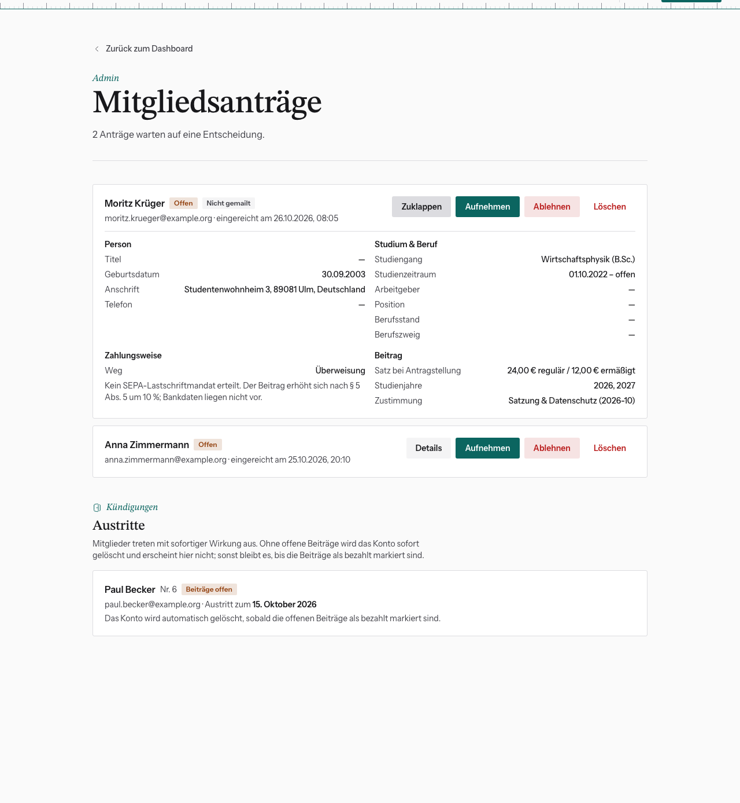
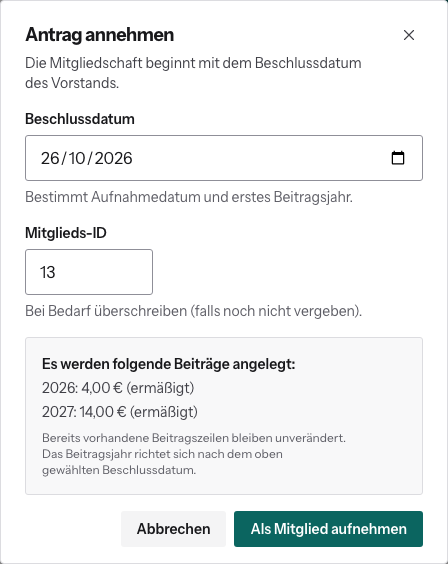

# Mitgliedsantrag bearbeiten

So läuft eine Aufnahme ab: Jemand registriert sich unter `/mitglied-werden`,
bestätigt die E-Mail-Adresse und füllt dort den Aufnahmeantrag aus. Der Antrag
landet bei dir. Bis zur Aufnahme hat die Person nur ein Konto, aber keine
Mitgliedschaft.

Dashboard → **Anträge & Austritte** (`/dashboard/mitgliedsantraege`). Der Badge
„x offen“ auf der Kachel zeigt, wie viele Anträge warten. Neue Anträge kommen
außerdem per Mail an alle Admins (Feature Flag „Mitgliedsantrag: Benachrichtigung
an Admins“).

## Antrag prüfen

**Details** klappt alle Angaben auf: Person, Studium & Beruf, Zahlungsweise
(Lastschrift mit IBAN oder Überweisung) und Beitrag. Der **Satz bei
Antragstellung** ist eingefroren: Ändern sich die Beitragssätze zwischen Antrag
und Aufnahme, gilt für die Person trotzdem, was sie beantragt hat.

Das Badge **Nicht gemailt** heißt: Die Benachrichtigung an die Admins ist nicht
rausgegangen (Mail abgeschaltet oder Versand gescheitert). Der Antrag selbst ist
vollständig.

## Aufnehmen

1. **Aufnehmen** klicken.
2. **Beschlussdatum** eintragen, also das Datum, an dem der Vorstand die Aufnahme
   beschlossen hat. Es wird zum Aufnahmedatum und bestimmt das erste Beitragsjahr.
3. **Mitglieds-ID** prüfen. Vorgeschlagen ist die nächste freie.
4. Die Vorschau zeigt, welche Beitragseinträge angelegt werden: das
   Eintrittsjahr anteilig und, falls beantragt, alle Jahre mit Sonderstatus bis
   zum letzten. Deshalb bietet die Benutzerverwaltung manchmal Jahre weit in der
   Zukunft an.
5. **Als Mitglied aufnehmen**.

Danach ist die Person ordentliches Mitglied und steht mit ihren Beiträgen in der
Benutzerverwaltung. Sie bekommt eine Bestätigung mit ihrer Mitglieds-ID, sofern
das Feature Flag „Mitgliedsantrag: Eingangsbestätigung“ an ist.

## Ablehnen

**Ablehnen** → optional eine **Begründung** eintragen → bestätigen. Die
Begründung steht in der Ablehnungsmail (gleiches Feature Flag wie oben). Das
Konto bleibt bestehen, nur ohne Mitgliedschaft.

## Löschen

**Löschen** entfernt den Antrag endgültig, samt dokumentiertem SEPA-Mandat.
Nur für Testanträge oder offensichtlichen Unsinn. Für eine echte Absage nimm
**Ablehnen**, dann bleibt die Entscheidung nachvollziehbar.

Solange du nicht entschieden hast, kann die Person ihren Antrag selbst
zurückziehen.
