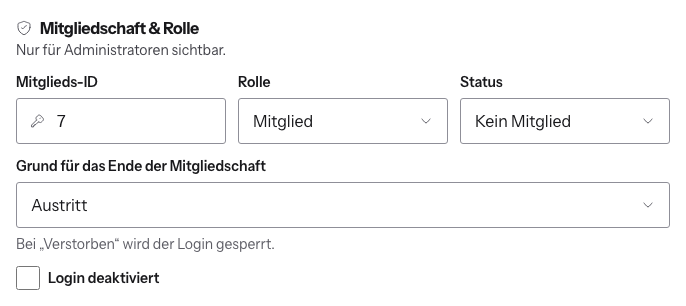

# Austritt, Ausschluss oder Tod eintragen

Wenn ein Austritt nicht über den Mitgliederbereich kommt, z. B. per Brief, oder
der Vorstand ein Mitglied nach § 6 ausschließt oder ein Mitglied verstorben ist,
trägst du das von Hand ein.

1. Benutzerverwaltung → Konto öffnen.
2. Im Adminbereich unter **Status** „Kein Mitglied“ wählen.
3. Es erscheint **Grund für das Ende der Mitgliedschaft**: **Austritt**,
   **Ausschluss** oder **Verstorben**.
4. Bei Bedarf **Login deaktiviert** anhaken.
5. **Speichern**.

## Was dabei passiert

- Die Website legt einen Austrittsnachweis mit heutigem Datum an. Er steht unter
  **Anträge & Austritte → Austritte** und wird nach drei Jahren automatisch
  gelöscht (Regelverjährung).
- Bei **Verstorben** wird der Login automatisch gesperrt.
- Ohne gesperrten Login bleibt die Person als Konto ohne Mitgliedschaft
  bestehen und kann sich weiter anmelden, z. B. für den Newsletter.
- **Beiträge passt die Website hier nicht an.** Prüfe in der
  Benutzerverwaltung, ob noch etwas offen ist. Einen Beitrag, der nicht mehr
  eingefordert wird, setzt du per [Ausnahme](../04-beitraege/beitraege-pflegen.md)
  auf 0 €.

Soll das Konto ganz weg, kannst du es jetzt [löschen](../02-konten/konto-loeschen.md).
