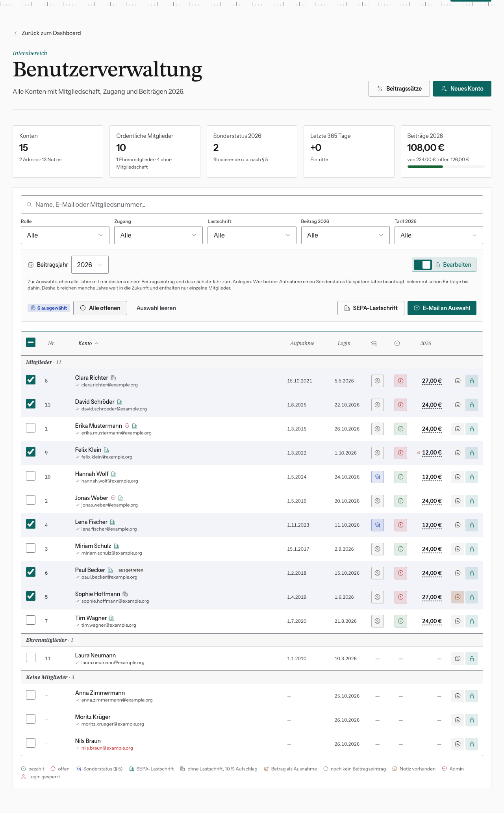

# Zahlungen und Ausnahmen pflegen

Alles passiert in der Tabelle der Benutzerverwaltung, immer für das oben
gewählte **Beitragsjahr**. Es muss zunächst für das kommende Jahr ein neues Beitragsjahr erstellt werden über das "+"-Symbol. Dieser Button setzt die Standardbeiträge für alle User für das Jahr in der Datenbank an.

## Erst freischalten

Zahlungsstatus, Sonderstatus und Beträge sind gegen Fehlklicks gesperrt.
Schalte zuerst **Bearbeiten** ein (der Tabellenrahmen wird farbig). Nach dem
Neuladen ist wieder alles gesperrt.

Steht bei jemandem nur „—“, gibt es für das Jahr noch keinen Beitragseintrag.
Dann lässt sich dort nichts abhaken. Lege zuerst die Einträge an, siehe
[Neues Beitragsjahr anlegen](beitragsjahr-anlegen.md).

## Als bezahlt markieren

Klick auf den runden Chip in der Spalte **Zahlung** (✓-Kreis):

- rot mit Ausrufezeichen = offen → Klick setzt auf **bezahlt** (grün)
- grün = bezahlt → Klick setzt zurück auf offen. Das fragt zur Sicherheit nach.

Typischer Ablauf: Kontoauszug neben die Tabelle legen, Filter **Beitrag → Offen**
setzen, Zahlungen abhaken.

## Sonderstatus umschalten

Klick auf den Chip in der Spalte **Tarif** (Doktorhut = Sonderstatus, Person =
regulär). Der Betrag passt sich sofort an. Das gilt nur für dieses eine Jahr.

## Abweichenden Betrag eintragen (Ausnahme)

Für Sonderfälle, z. B. eine Absprache, einen Erlass oder einen gestrichenen
Beitrag:

1. Auf den **Betrag** klicken.
2. **Abweichender Betrag (€)** eintragen, auch 0 ist möglich.
3. **Ausnahme speichern**.

Der Betrag ist jetzt fest und bekommt ein Stift-Symbol. Zurück zur Automatik
geht es im selben Dialog mit **Auf Standardbeitrag zurücksetzen**.

Schreib bei Ausnahmen kurz in die **Notiz** (Sprechblase), warum.

## Verlauf ansehen

Klick auf den **Namen** öffnet alle Beitragsjahre dieser Person mit Status und
Betrag.

Abschalten lässt sich das über das Feature Flag „Beitragsänderungen“.
