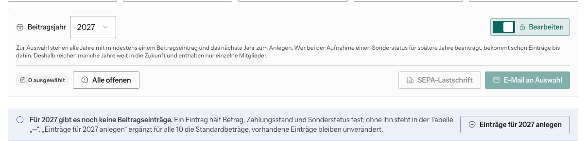

# Neues Beitragsjahr anlegen

Zum Jahreswechsel legst du für alle Mitglieder die Beitragseinträge des neuen
Jahres an. Erst ein **Eintrag** hält Betrag, Zahlungsstand und Sonderstatus
fest. Ohne Eintrag steht in der Tabelle nur „—“, und das Jahr taucht weder in
den Kennzahlen noch in der SEPA-Datei auf.

## So geht's

1. Benutzerverwaltung.
2. Unter **Beitragsjahr** das neue Jahr wählen. Im Menü stehen alle Jahre mit
   mindestens einem Eintrag und **genau ein Jahr mehr**, das zum Anlegen.
3. Schalter **Bearbeiten** einschalten.
4. Im blauen Hinweis „Für … gibt es noch keine Beitragseinträge“ auf
   **Einträge für … anlegen** klicken.

Danach erscheinen die Beträge in der Tabelle, alle als **offen**. Das nächste
Jahr ist ab jetzt im Menü wählbar.

## Was dabei passiert

- Einen Eintrag bekommen alle **ordentlichen Mitglieder**, die in diesem Jahr
  schon dabei waren. Ehrenmitglieder und Konten ohne Mitgliedschaft nicht.
- Die Beträge folgen dem Standardsatz (siehe
  [Beitragssätze](beitragssaetze.md)).
- Den **Sonderstatus** übernimmt die Website aus den Jahren, die das Mitglied
  angegeben hat. Fehlen solche Angaben, gilt der Status des Vorjahres weiter.
- Schon vorhandene Einträge bleiben unverändert. Du kannst den Knopf also
  gefahrlos ein zweites Mal drücken.

## Hinweis „Erst x von y Mitgliedern haben einen Beitragseintrag“

Der Hinweis erscheint, wenn in einem Jahr nur **einem Teil** der Mitglieder ein
Eintrag fehlt, z. B. nach einer Aufnahme mitten im Jahr oder einem von Hand
angelegten Konto. Der Knopf **Einträge für … anlegen** ergänzt dann nur die
fehlenden.

## Warum manche Jahre weit in der Zukunft liegen

Wer bei der Aufnahme einen Sonderstatus für spätere Jahre beantragt, z. B. als
Student bis 2029, bekommt schon bei der Aufnahme Einträge bis dahin. Deshalb
kann das Menü Jahre wie 2029 anbieten, in denen nur einzelne Mitglieder
stehen. Das ist kein Fehler. Für alle anderen legst du diese Jahre ganz normal
an, wenn es so weit ist.
