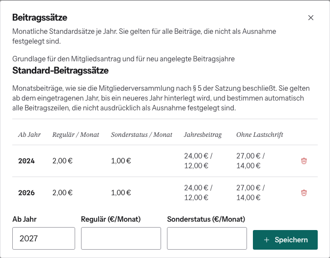

# Beitragssätze festlegen

Die Sätze beschließt die Mitgliederversammlung. Auf der Website trägst du sie
einmal ein, ab dann rechnet alles damit: neue Beitragsjahre, Aufnahmeanträge
und die Beitragsvorschau im Antrag.

1. Benutzerverwaltung → oben rechts **Beitragssätze**.
2. Unten **Ab Jahr**, **Regulär (€/Monat)** und **Sonderstatus (€/Monat)**
   eintragen.
3. **Speichern**.

## So gelten die Sätze

- Ein Satz gilt **ab dem eingetragenen Jahr**, bis ein neueres Jahr hinterlegt
  ist. Du musst also nicht jedes Jahr einen Eintrag anlegen, nur bei einer
  Änderung.
- Die Tabelle zeigt zur Kontrolle den Jahresbeitrag und den Betrag ohne
  Lastschrift.
- Mit dem Papierkorb entfernst du einen Eintrag. Dann gilt für diese Jahre
  wieder der vorherige Satz.

**Achtung:** Ein neuer oder geänderter Satz ändert sofort alle
**Standard-Beiträge** der betroffenen Jahre, auch schon angelegte und offene.
Ausnahmen und laufende Aufnahmeanträge (eingefrorener Satz) bleiben unberührt.

Abschalten lässt sich das über das Feature Flag „Beitragsänderungen“.
