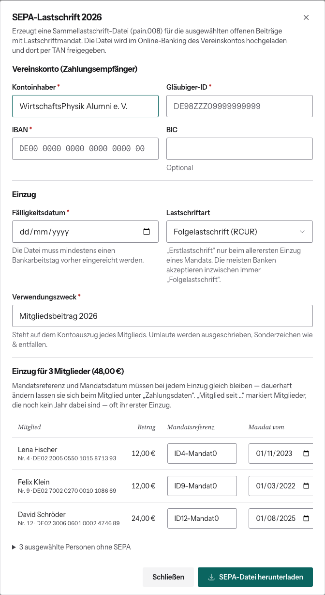

# SEPA-Lastschrift erzeugen

Die Website erzeugt eine Sammellastschrift-Datei (Format pain.008). Die lädst
du im Online-Banking des Vereinskontos hoch und gibst sie dort per TAN frei. Geld
bewegt die Website selbst nicht.

## Datei erzeugen

1. Benutzerverwaltung → Beitragsjahr wählen.
2. **Alle offenen** klicken (oder einzelne Konten anhaken).
3. **SEPA-Lastschrift**.
4. **Vereinskonto** ausfüllen: Kontoinhaber, Gläubiger-ID, IBAN, BIC
   (optional). Diese Angaben sind nicht vorbelegt, halte sie bereit.
5. **Einzug** festlegen:
   - **Fälligkeitsdatum**: frühestens morgen. Die Datei muss mindestens einen
     Bankarbeitstag vorher bei der Bank sein.
   - **Lastschriftart**: „Folgelastschrift (RCUR)“ passt fast immer.
     „Erstlastschrift (FRST)“ nur beim allerersten Einzug eines Mandats, falls
     die Bank das verlangt.
   - **Verwendungszweck**: vorbelegt mit „Mitgliedsbeitrag <Jahr>“. Umlaute
     werden ausgeschrieben, Sonderzeichen wie & fallen weg.
6. Liste prüfen: Mandatsreferenz und Mandatsdatum je Mitglied.
7. **SEPA-Datei herunterladen**.

## Wer in die Datei kommt

Nur ordentliche Mitglieder mit **angelegtem, offenem** Beitragseintrag **und**
Lastschriftmandat. Fehlen für das Jahr noch Einträge, [lege sie zuerst an](beitragsjahr-anlegen.md),
sonst fehlen diese Mitglieder in der Datei. Alle anderen
(bezahlt, ohne Mandat, ausgetreten, beitragsfrei) stehen eingeklappt unter
„… ausgewählte Personen ohne SEPA“. Fehlen bei jemandem Bankdaten, erscheint
eine gelbe Warnung mit dem Namen. Diese Person ist nicht in der Datei.

**Mandatsreferenz und Mandatsdatum** müssen bei jedem Einzug gleich bleiben.
Ändere sie dauerhaft im Profil unter „Zahlungsdaten“, nicht nur hier im Dialog.
„Mitglied seit …“ markiert Leute, die noch kein Jahr dabei sind. Das ist oft ihr
erster Einzug.

## Danach

1. Datei im Online-Banking hochladen und freigeben.
2. **Nach dem Einzug** die Beiträge in der Benutzerverwaltung als bezahlt
   markieren, siehe [Zahlungen pflegen](beitraege-pflegen.md). Die Website
   setzt das **nicht** automatisch.
3. Rücklastschriften: Beitrag wieder auf offen setzen und die Person
   kontaktieren.
