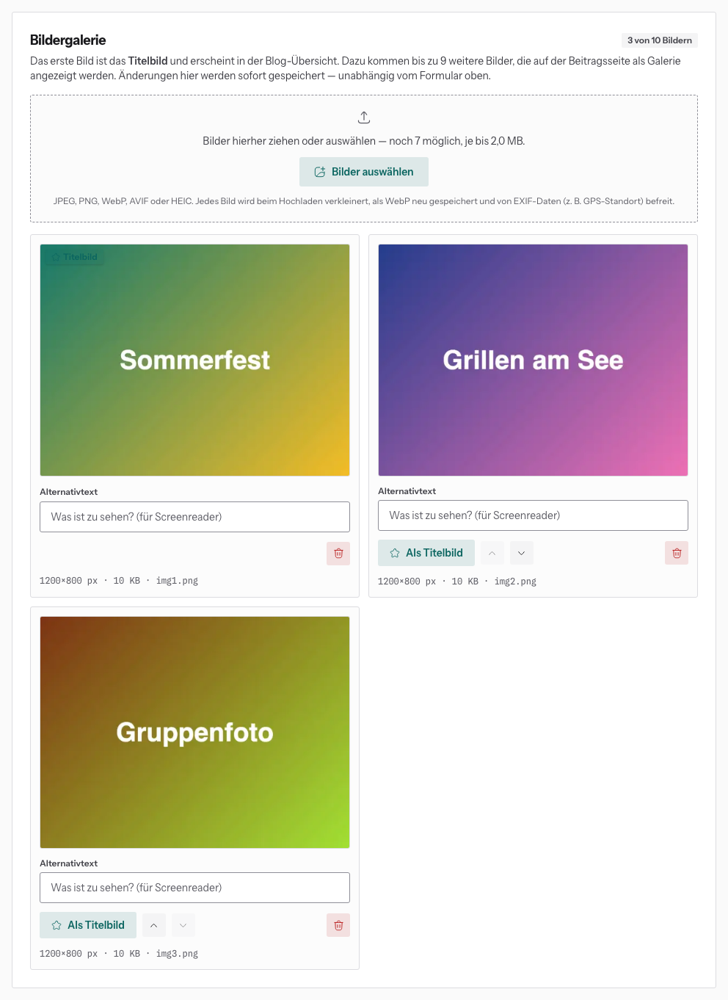

# Bilder im Blog

Unter dem Beitragsformular liegt die **Bildergalerie**. Pro Beitrag gibt es
**bis zu 10 Bilder**: ein Titelbild und bis zu 9 weitere.

## Hochladen

Bilder ins gestrichelte Feld ziehen oder auswählen. Mehrere auf einmal gehen.

- je Datei **höchstens 2 MB**
- JPEG, PNG, WebP, AVIF, GIF, TIFF oder HEIC (iPhone-Fotos gehen direkt)
- Die Website verkleinert jedes Bild, speichert es als WebP und **entfernt
  EXIF-Daten** wie den GPS-Standort.

Größere Fotos vorher verkleinern, z. B. am Handy über „Teilen → Größe ändern“.

## Ordnen

- Das **erste** Bild ist das **Titelbild**. Es erscheint in der Blog-Übersicht.
- **Als Titelbild** macht ein anderes Bild zum ersten.
- Die Pfeile verschieben ein Bild nach vorne oder hinten.
- Der Papierkorb löscht ein Bild (mit Rückfrage).

## Alternativtext

Beschreib kurz, was zu sehen ist, z. B. „Gruppenfoto am Uni-See“. Screenreader
lesen den Text vor, und er erscheint, wenn ein Bild nicht lädt.

Alle Änderungen in der Galerie sind **sofort gespeichert**, unabhängig vom
Knopf „Speichern“ im Formular darüber.
