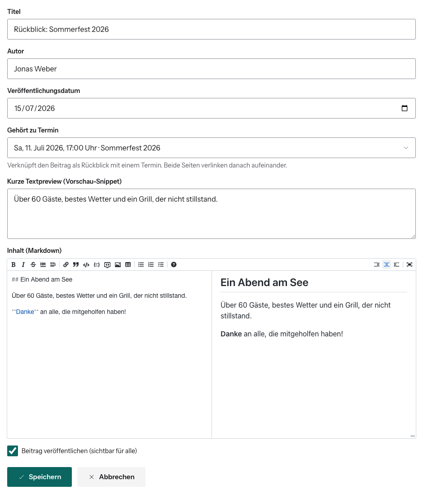

# Blogbeitrag schreiben

Dashboard → **Blog** → **Neuer Beitrag**. Der Beitrag entsteht als
**Entwurf**. Öffentlich sichtbar wird er erst, wenn du ihn veröffentlichst.



## Felder

| Feld | Hinweis |
|---|---|
| **Titel** | |
| **Autor** | frei wählbarer Name |
| **Veröffentlichungsdatum** | bestimmt die Reihenfolge im Blog |
| **Gehört zu Termin** | macht den Beitrag zum **Rückblick** auf einen Termin. Beide Seiten verlinken dann aufeinander. |
| **Kurze Textpreview** | Pflichtfeld. Steht in der Blog-Übersicht unter dem Titel. |
| **Inhalt** | Markdown: links schreiben, rechts Vorschau |
| **Beitrag veröffentlichen** | Haken = sichtbar für alle |

**Speichern** nicht vergessen. Die [Bildergalerie](blog-bilder.md) darunter
speichert dagegen sofort und unabhängig vom Formular.

## Markdown in 30 Sekunden

```markdown
## Zwischenüberschrift
**fett**, *kursiv*, [Linktext](https://example.org)
- Aufzählung
1. Nummeriert
```

Die Werkzeugleiste über dem Editor fügt das auch per Klick ein.

## Wo der Beitrag erscheint

- unter `/blog` (Titelbild, Lesezeit, Vorschautext) und im RSS-Feed
  `/blog/feed.xml`
- der neueste Beitrag auf der Startseite
- bei Verknüpfung mit einem Termin: auf dessen Seite als „Rückblick“

**Löschen** in der Übersicht fragt nach und ist endgültig, samt Bildern.

Abschalten lässt sich das über das Feature Flag „Blog-Verwaltung“. Die
öffentliche Seite blendet „Seite: Blog“ aus.
