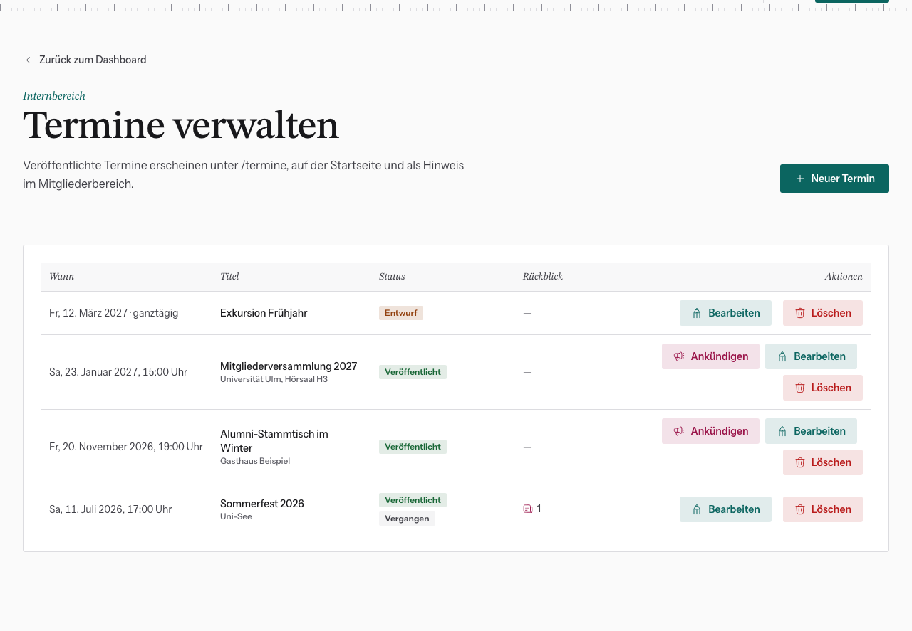
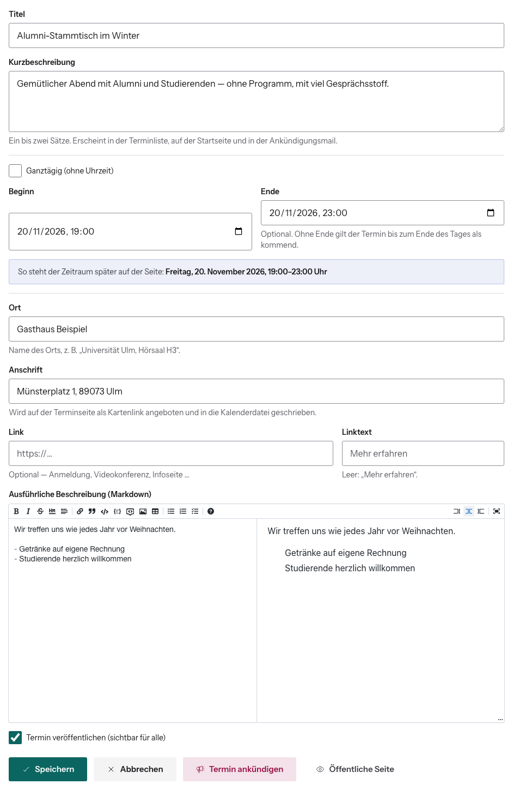

# Termin anlegen

Dashboard → **Termine** → **Neuer Termin**. Der Termin entsteht sofort als
**Entwurf**. Öffentlich sichtbar wird er erst, wenn du ihn veröffentlichst.

## Felder

| Feld | Hinweis |
|---|---|
| **Titel** | z. B. „Sommerstammtisch im Biergarten“ |
| **Kurzbeschreibung** | ein bis zwei Sätze. Steht in der Terminliste, auf der Startseite und in der Einladungsmail. |
| **Ganztägig** | ohne Uhrzeit, z. B. für Exkursionen |
| **Beginn / Ende** | Ende ist optional. Ohne Ende gilt der Termin bis zum Ende des Starttags als kommend. |
| **Ort** | Name des Orts, z. B. „Universität Ulm, Hörsaal H3“ |
| **Anschrift** | wird als Kartenlink angeboten und in die Kalenderdatei geschrieben |
| **Link / Linktext** | optional: Anmeldung, Videokonferenz, Infoseite. Ohne Linktext steht dort „Mehr erfahren“. |
| **Ausführliche Beschreibung** | Markdown, links schreiben, rechts Vorschau |
| **Termin veröffentlichen** | Haken = sichtbar für alle |

Unter Beginn/Ende zeigt ein blauer Kasten, wie der Zeitraum später auf der
Seite steht. Kontrollier hier Datum und Uhrzeit.

## Wo veröffentlichte Termine erscheinen

- unter `/termine` mit eigener Detailseite und Kalenderdatei (`.ics`)
- auf der Startseite (der nächste anstehende Termin)
- im Dashboard aller Mitglieder als Hinweis, wenn er in den nächsten drei
  Monaten liegt

Vergangene Termine bekommen in der Liste das Badge **Vergangen** und sind
öffentlich unter „Vergangenes“ zu finden. Ein eigenes Statusfeld dafür gibt es
nicht.

## Danach

- **Termin ankündigen** (nach dem Speichern, nur bei veröffentlichten Terminen):
  siehe [Zu einem Termin einladen](../06-kommunikation/zu-termin-einladen.md).
- **Öffentliche Seite** öffnet die Terminseite in einem neuen Tab.
- Nach dem Termin einen [Rückblick im Blog](blogbeitrag-schreiben.md) schreiben.
  Die Spalte **Rückblick** in der Liste zählt verknüpfte Beiträge.

**Löschen** fragt nach. Verknüpfte Blogbeiträge bleiben erhalten und verlieren
nur die Verknüpfung.

Abschalten lässt sich das über das Feature Flag „Termin-Verwaltung“. Die
öffentliche Seite blendet „Seite: Termine“ aus.
