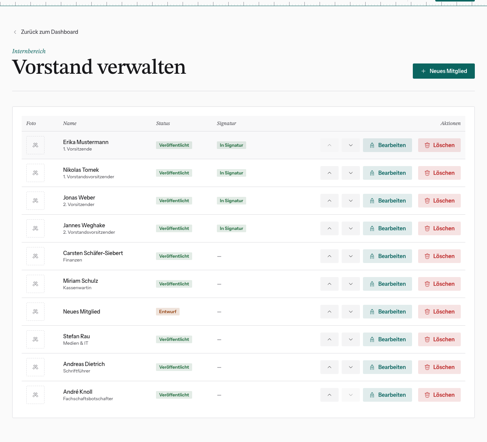
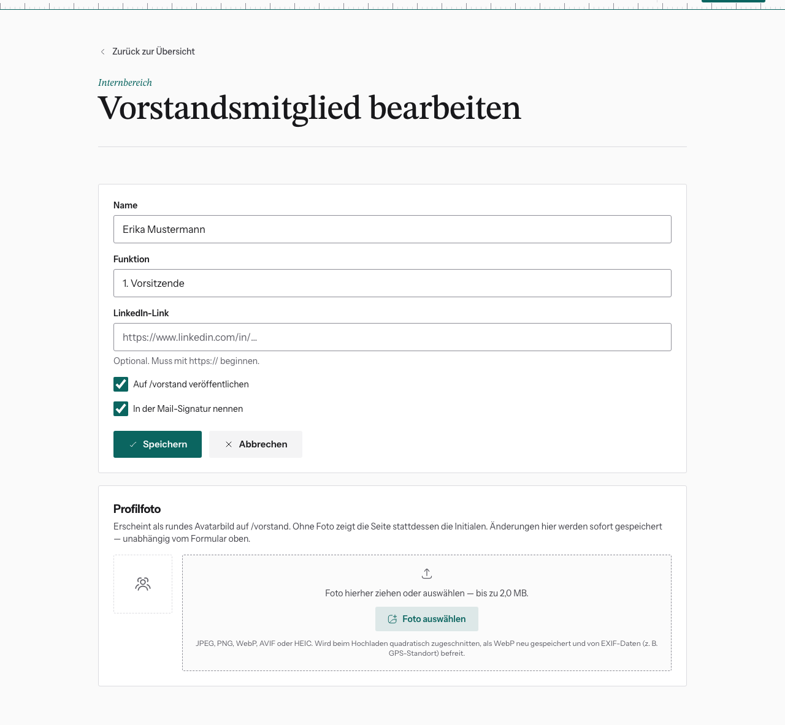

# Vorstand und Signatur pflegen

Dashboard → **Vorstand**. Hier pflegst du die öffentliche Seite `/vorstand`
und legst fest, wer **für den Verein zeichnet**.

## Mitglied anlegen oder bearbeiten

1. **Neues Mitglied** (legt einen unveröffentlichten Entwurf an) oder
   **Bearbeiten** bei einem bestehenden Eintrag.
2. **Name**, **Funktion** (z. B. „1. Vorsitzende“), optional **LinkedIn-Link**
   (muss mit `https://` beginnen).
3. **Auf /vorstand veröffentlichen**: sichtbar auf der öffentlichen Seite.
4. **In der Mail-Signatur nennen**: siehe unten.
5. **Speichern**.
6. Optional ein **Profilfoto** hochladen (bis 2 MB). Es wird quadratisch
   zugeschnitten und erscheint rund. Ohne Foto zeigt die Seite die Initialen.
   Das Foto ist sofort gespeichert.

## Die Signatur: wichtiger, als der Name sagt

Wer **veröffentlicht ist und** den Haken **In der Mail-Signatur nennen** hat,
erscheint an drei Stellen:

| Wo | Wie |
|---|---|
| **jede Mail** der Website (Rundmails und Systemmails) | Zeile „Name (Funktion) · Name (Funktion)“ in der Signatur |
| **Impressum** | als vertretungsberechtigter Vorstand |
| **Mitgliedschaftszertifikat** (PDF) | in der Unterschriftenleiste |

Nach jeder Vorstandswahl deshalb hier aktualisieren: neue Vorsitzende
eintragen und anhaken, ausgeschiedene abhaken oder löschen. Das Impressum ist
eine rechtliche Pflichtangabe. Dort müssen die vertretungsberechtigten
Vorstandsmitglieder stimmen.

Ist niemand angehakt, steht in Mails eine Signatur ohne Namen.

## Reihenfolge

Die Pfeile in der Liste verschieben Einträge nach oben oder unten. Die
Reihenfolge gilt für `/vorstand`, die Signatur, das Impressum und das
Zertifikat.

Abschalten lässt sich das über das Feature Flag „Vorstands-Verwaltung“. Die
Seite `/vorstand` blendet „Seite: Vorstand“ aus. Signatur und Impressum
betrifft das nicht.
