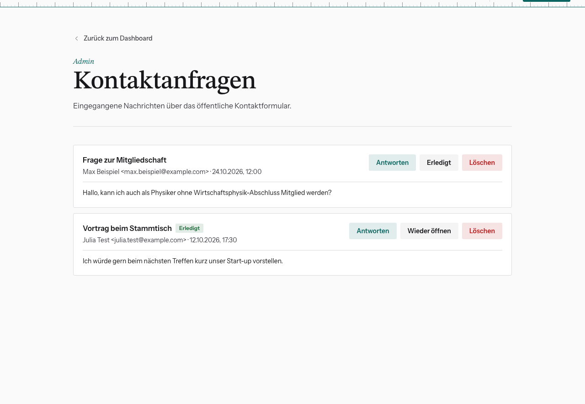

# Kontaktanfragen bearbeiten

Nachrichten aus dem Formular unter `/kontakt` kommen auf zwei Wegen an, jeweils
mit eigenem Feature Flag:

- **per Mail an alle Admins** („Kontaktformular: Benachrichtigung per Mail“)
- **gespeichert im Dashboard** („Kontaktformular: Speicherung in der Datenbank“)

Dashboard → **Kontaktanfragen** (`/dashboard/kontakt`).

## Pro Anfrage

- **Antworten** öffnet dein Mailprogramm mit Adresse und Betreff. Die Antwort
  geht also von deiner eigenen Adresse raus, nicht von der Website.
- **Erledigt** klicken, wenn sich jemand gekümmert hat. Die Anfrage bekommt das
  gleichnamige Badge. So sehen die anderen Admins, dass sie nichts mehr tun
  müssen. **Wieder öffnen** nimmt das zurück.
- **Löschen** entfernt die Anfrage endgültig (mit Rückfrage).

## Badges

| Badge | Bedeutung |
|---|---|
| **Erledigt** | jemand hat sich gekümmert |
| **Spam-Verdacht (Zahl)** | Der Spamfilter hält die Nachricht für verdächtig. Sie wurde deshalb **nicht** gemailt und steht nur hier. Kurz drüberschauen, meist löschen. |
| **Nicht gemailt** | Die Mail an die Admins ist nicht rausgegangen (abgeschaltet oder gescheitert). Hier findest du die Anfrage trotzdem. |

Lösch erledigte Anfragen regelmäßig. Sie enthalten personenbezogene Daten, und
die bewahrt der Verein nicht länger auf als nötig.

Spam-Wellen: siehe [Notfall: eine Funktion abschalten](../07-technik/notfall-abschalten.md).
