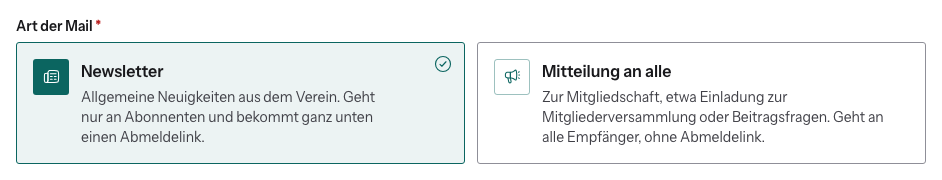

# Newsletter oder Mitteilung?

Bei jeder Rundmail musst du dich entscheiden. Davon hängt ab, wer die Mail
bekommt.

| | Newsletter | Mitteilung an alle |
|---|---|---|
| Inhalt | Neuigkeiten, Veranstaltungen, Blog-Hinweise | Mitgliedschaft: Mitgliederversammlung, Beiträge, Satzung |
| Wer bekommt sie | nur, wer den Newsletter nicht abbestellt hat | alle gewählten Empfänger |
| Abmeldelink | ja, ganz unten in der Mail | nein |

**Faustregel:** Wenn die Mail auch für jemanden wichtig ist, der „keine
Werbung“ will, ist es eine Mitteilung. Sonst ist es ein Newsletter.

Nutze „Mitteilung an alle“ nicht, um Abmeldungen zu umgehen. Wer abbestellt
hat, hat das ausdrücklich so gewollt.

## Wie der Newsletter-Status entsteht

- **Jedes Konto ist am Anfang angemeldet.**
- Abbestellen geht
  - über den **Abmeldelink** in jedem Newsletter (ein Klick, ohne Login),
  - im Dashboard unter **Mein Konto → Newsletter**,
  - im eigenen Profil.
- Wieder anmelden geht im Dashboard.
- Bei einem **Austritt** wird der Newsletter automatisch abbestellt.

**Als Admin kannst du den Status anderer nicht ändern**, nur sehen: im Profil
der Person und in der Empfängerauswahl der Rundmail (Badge **Kein Newsletter**).
Will jemand per Mail an- oder abgemeldet werden, verweise auf den Schalter im
Dashboard.

Mail-Programme wie Gmail bieten bei Newslettern zusätzlich einen eigenen
„Abbestellen“-Knopf an. Der funktioniert ebenfalls.
