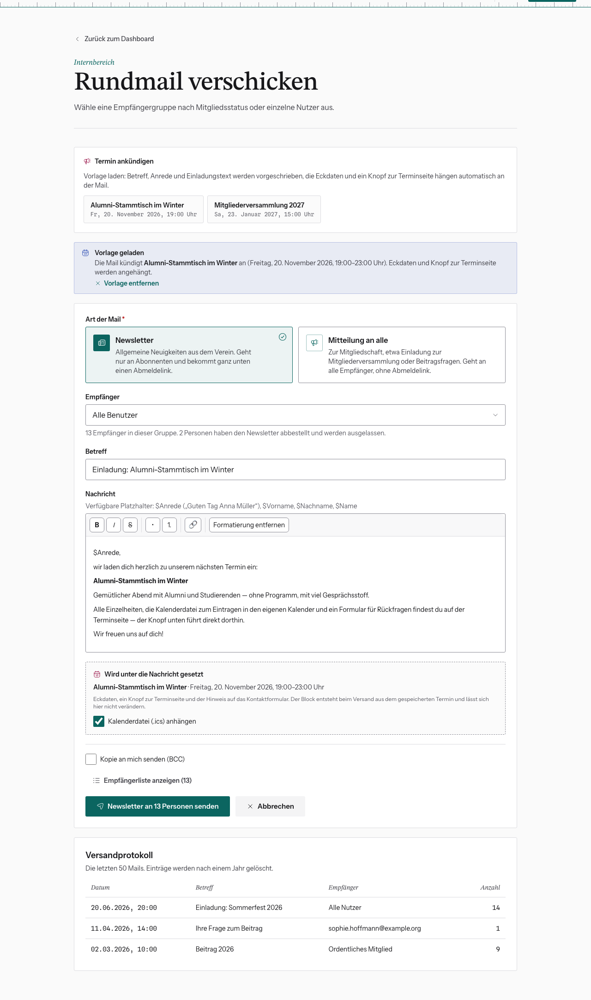

# Zu einem Termin einladen

Für Einladungen gibt es eine fertige Vorlage. Du musst nichts abtippen, und Ort,
Zeit und Link stimmen garantiert mit der Terminseite überein.

## Voraussetzung

Der Termin ist **veröffentlicht und gespeichert**. Für einen Entwurf lehnt die
Website die Einladung ab, weil der Knopf in der Mail sonst auf eine Seite zeigen
würde, die es öffentlich nicht gibt.

## So geht's

1. Einen der drei Wege nehmen:
   - **Termine** → in der Zeile **Ankündigen**
   - im Termin → **Termin ankündigen**
   - **Rundmail** → oben unter **Termin ankündigen** auf den Termin klicken
     (dort stehen die nächsten acht)
2. Es erscheint **Vorlage geladen**. Betreff („Einladung: <Titel>“) und Text
   sind vorbefüllt:

   > $Anrede,
   > wir laden dich herzlich zu unserem nächsten Termin ein:
   > **<Titel>**
   > <Kurzbeschreibung>
   > …

3. Text nach Belieben anpassen.
4. **Art der Mail** und **Empfänger** wählen (Tipps unten).
5. **Kalenderdatei (.ics) anhängen** ist angehakt. Lass das so, dann können sich
   alle den Termin mit einem Klick eintragen.
6. Senden.

## Was automatisch angehängt wird

Unter deinem Text setzt die Website einen festen Block mit den **Eckdaten**
(Datum, Uhrzeit, Ort), einem **Knopf zur Terminseite** und dem Hinweis auf das
Kontaktformular für Rückfragen. Den Block kannst du nicht bearbeiten. Er entsteht
beim Versand aus dem gespeicherten Termin. Willst du etwas ändern, ändere den
Termin.

**Vorlage entfernen** macht daraus wieder eine normale Rundmail.

## Newsletter oder Mitteilung?

| Termin | Art | Empfänger |
|---|---|---|
| Stammtisch, Sommerfest, Vortrag | **Newsletter** | Alle Benutzer |
| Mitgliederversammlung | **Mitteilung an alle** | Ordentliches Mitglied, danach dieselbe Mail an Ehrenmitglied |

Die Einladung zur Mitgliederversammlung ist eine Vereinsangelegenheit und muss
auch Leute erreichen, die den Newsletter abbestellt haben. Mehr dazu in
[Newsletter oder Mitteilung?](newsletter.md).
