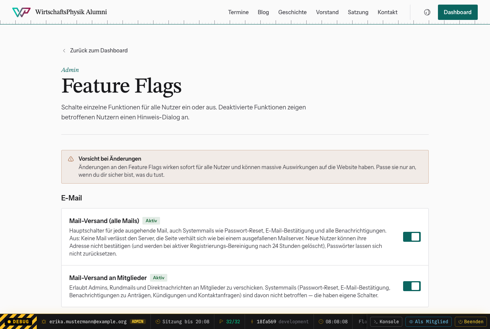

# Feature Flags

Dashboard → Debug-Modus an → **Feature Flags** (`/dashboard/feature-flags`).
Mit Feature Flags schaltest du einzelne Funktionen ab, ohne dass jemand am Code
oder am Server etwas ändern muss. Praktisch für Wartung, Spam-Wellen oder wenn
eine Funktion Probleme macht.

## Bedienung

Schalter umlegen, fertig. Die Änderung gilt **sofort für alle**. Ein Badge
zeigt „Aktiv“ oder „Deaktiviert“. Wer eine abgeschaltete Funktion nutzen will,
bekommt einen Hinweisdialog.

Wie viele Flags gerade an sind, zeigt die [Debug-Leiste](../01-grundlagen/debug-modus.md)
(z. B. `31/32`). Fahr mit der Maus darüber, dann siehst du, welche aus sind.

**Schalte nach einer Störung alles wieder ein.** Ein vergessenes Flag fällt oft
erst Wochen später auf, z. B. wenn niemand mehr Anträge stellen kann.

## Wichtige Zusammenhänge

- **„Mail-Versand (alle Mails)“ ist der Hauptschalter.** Ist er aus, geht gar
  keine Mail raus, auch keine Passwort-Links und Bestätigungen. Alle anderen
  Mail-Schalter wirken nur, wenn er an ist.
- **„Login“ aus sperrt nur Mitglieder aus.** Admins kommen immer rein.
- Seiten-Schalter (**Seite: …**) blenden öffentliche Seiten aus. Die Adresse
  liefert dann „nicht gefunden“, die Links verschwinden. Die Verwaltung im
  Dashboard bleibt nutzbar.
- „Kontaktformular: Benachrichtigung per Mail“ und „… Speicherung in der
  Datenbank“ gleichzeitig aus heißt: **Anfragen gehen verloren.** Lass mindestens
  einen an.

## Alle Schalter

### E-Mail

| Schalter | Was er tut |
|---|---|
| **Mail-Versand (alle Mails)** | Hauptschalter für jede ausgehende Mail, auch Systemmails wie Passwort-Reset, E-Mail-Bestätigung und alle Benachrichtigungen. Aus: Keine Mail verlässt den Server, die Seite verhält sich wie bei einem ausgefallenen Mailserver. Neue Nutzer können ihre Adresse nicht bestätigen (und werden bei aktiver Registrierungs-Bereinigung nach 24 Stunden gelöscht), Passwörter lassen sich nicht zurücksetzen. |
| **Mail-Versand an Mitglieder** | Erlaubt Admins, Rundmails und Direktnachrichten an Mitglieder zu verschicken. Systemmails (Passwort-Reset, E-Mail-Bestätigung, Benachrichtigungen zu Anträgen, Kündigungen und Kontaktanfragen) sind davon nicht betroffen — die haben eigene Schalter. |

### Konto & Anmeldung

| Schalter | Was er tut |
|---|---|
| **Login** | Erlaubt Mitgliedern das Einloggen in den Mitgliederbereich. |
| **Registrierung** | Erlaubt die Registrierung neuer Mitglieder. |
| **E-Mail-Verifizierung** | Erlaubt Nutzern, ihre E-Mail-Adresse über den Bestätigungslink zu verifizieren. |
| **Registrierung: unbestätigte Konten löschen** | Löscht selbst registrierte Konten automatisch, deren E-Mail-Adresse nach 24 Stunden nicht bestätigt ist. Aus: Unbestätigte Registrierungen bleiben stehen und müssen von Hand gelöscht werden. Von Admins angelegte Konten und der Altbestand sind nie betroffen. |
| **Passwort zurücksetzen** | Erlaubt das Zurücksetzen des Passworts per E-Mail. |
| **E-Mail-Änderung** | Erlaubt Mitgliedern, ihre hinterlegte E-Mail-Adresse zu ändern. |
| **Profil bearbeiten** | Erlaubt das Bearbeiten von Profildaten (durch Mitglieder und Admins). |
| **Konto: Mail bei Sperrung oder Löschung** | Informiert Nutzer per Mail, wenn sie ihren Zugang deaktiviert oder ihr Konto gelöscht haben — auch als Warnung, falls das jemand anderes war. |

### Mitgliedschaft

| Schalter | Was er tut |
|---|---|
| **Mitgliedsantrag** | Schaltet den Antrag auf Vereinsmitgliedschaft im Mitgliederbereich ein oder aus. Aus: Nicht-Mitglieder können keinen neuen Antrag stellen; bereits eingegangene Anträge bleiben im Dashboard bearbeitbar. |
| **Mitgliedsantrag: Benachrichtigung an Admins** | Benachrichtigt alle Admins per Mail über einen neuen Aufnahmeantrag. Aus: Anträge werden nur noch im Dashboard gesammelt. |
| **Mitgliedsantrag: Eingangsbestätigung** | Schickt dem Antragsteller eine Eingangsbestätigung sowie eine Mail bei Annahme oder Ablehnung. |
| **Austritt im Mitgliederbereich** | Erlaubt Mitgliedern, im Mitgliederbereich mit sofortiger Wirkung auszutreten — ohne offene Beiträge samt Löschung des Kontos. Aus: Mitglieder sehen stattdessen den Hinweis, sich per Kontaktformular oder E-Mail an den Vorstand zu wenden. |
| **Austritt: Benachrichtigung an Admins** | Benachrichtigt alle Admins mit Name und letzter E-Mail-Adresse über einen Austritt und über die spätere Löschung nach Zahlung offener Beiträge. Aus: Austritte ohne offene Beiträge hinterlassen keine Spur — der Vorstand erfährt nichts davon. |
| **Austritt: Mails an das Mitglied** | Bestätigt dem Mitglied den Austritt (mit offenen Beiträgen, falls vorhanden) und später die Löschung des Kontos. Aus: Das Mitglied sieht den Austritt nur im Mitgliederbereich. |

### Öffentliche Seiten

| Schalter | Was er tut |
|---|---|
| **Seite: Termine** | Blendet /termine samt Termin-Detailseiten und Kalender-Downloads ein oder aus. Aus: Die Adressen liefern 404, Links in Navigation, Footer und auf der Startseite verschwinden. Die Termin-Verwaltung im Dashboard bleibt nutzbar. |
| **Seite: Blog** | Blendet /blog samt Beiträgen und RSS-Feed ein oder aus. Aus: Die Adressen liefern 404, Links in Navigation, Footer und auf der Startseite verschwinden. Die Blog-Verwaltung im Dashboard bleibt nutzbar. |
| **Seite: Geschichte** | Blendet /geschichte ein oder aus. Aus: Die Adresse liefert 404, Links und der Zeitstrahl auf der Startseite verschwinden. |
| **Seite: Vorstand** | Blendet /vorstand ein oder aus. Aus: Die Adresse liefert 404, Links verschwinden. Die Vorstands-Verwaltung und die Mail-Signatur sind nicht betroffen. |
| **Seite: Satzung** | Blendet /satzung ein oder aus. Aus: Die Adresse liefert 404, Links verschwinden. Achtung: Andere Seiten (z. B. der Mitgliedsantrag) verweisen womöglich weiterhin auf die Satzung. |

### Mitgliederbereich

| Schalter | Was er tut |
|---|---|
| **Alumni-Kosmos** | Schaltet den Alumni-Kosmos im Mitgliederbereich ein oder aus. Aus: Niemand sieht den Zeitstrahl oder kann E-Mail-Adressen aufdecken; Mitglieder können ihre Sichtbarkeit weiterhin ausschalten. |
| **PDF-Dokumente** | Erlaubt Mitgliedern, ihre Zahlungshistorie und ihr Mitgliedschaftszertifikat als PDF herunterzuladen. Aus: Die Download-Knöpfe verschwinden, die Angaben bleiben im Mitgliederbereich sichtbar. |

### Kontaktformular

| Schalter | Was er tut |
|---|---|
| **Kontaktformular** | Schaltet das öffentliche Kontaktformular unter /kontakt komplett ein oder aus. |
| **Kontaktformular: Benachrichtigung per Mail** | Verschickt bei jeder Anfrage eine Benachrichtigung an alle Admins. Aus: Anfragen werden nur noch im Dashboard gesammelt. |
| **Kontaktformular: Speicherung in der Datenbank** | Speichert eingehende Anfragen in der Datenbank. Aus: Anfragen werden nur noch per Mail zugestellt und sind später nicht mehr einsehbar. |

### Verwaltung

| Schalter | Was er tut |
|---|---|
| **Nutzer anlegen** | Erlaubt Admins, neue Benutzerkonten manuell anzulegen. |
| **Nutzer löschen** | Erlaubt Admins, Benutzerkonten unwiderruflich zu löschen. |
| **Beitragsänderungen** | Erlaubt Admins, Mitgliedsbeiträge zu ändern. |
| **Blog-Verwaltung** | Erlaubt Admins, Blogbeiträge zu erstellen, zu bearbeiten oder zu löschen. |
| **Termin-Verwaltung** | Erlaubt Admins, Termine anzulegen, zu bearbeiten oder zu löschen. Aus: Bereits veröffentlichte Termine bleiben unter /termine sichtbar, lassen sich aber nicht mehr ändern. |
| **Vorstands-Verwaltung** | Erlaubt Admins, Vorstandsmitglieder anzulegen, zu bearbeiten oder zu löschen. Aus: Die Seite /vorstand und die Mail-Signatur bleiben mit dem zuletzt gespeicherten Stand sichtbar, lassen sich aber nicht mehr ändern. |
