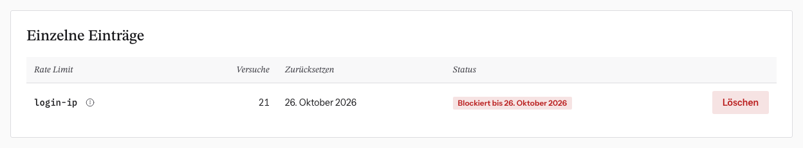

# Rate-Limit-Sperre aufheben

Rate Limits bremsen zu viele Versuche in kurzer Zeit, z. B. falsche Passwörter.
Wer an eine Grenze stößt, wird für eine Weile gesperrt und sieht die Meldung
„Zu viele Versuche …“.

**Meist musst du nichts tun:** Die Sperren laufen von selbst ab, beim Login nach
10 bis 15 Minuten.

## Wenn es eilt

Ein Mitglied hat sich ausgesperrt und kann nicht warten:

1. Debug-Modus an → **Sicherheit** → ganz unten **Einzelne Einträge**.
2. Den Eintrag mit **Blockiert bis …** suchen. Achte auf den passenden Namen
   (siehe unten) und darauf, dass er zeitlich zur Meldung passt.
3. **Löschen**. Die Person kann es sofort wieder versuchen.

Wer genau gesperrt ist, siehst du nicht, denn Adressen stehen nur als
Pseudonym da. Im Zweifel ist Löschen harmlos: Es setzt nur den Zähler zurück.

## Die häufigsten Namen

| Name | Zählt | Grenze |
|---|---|---|
| `login` | Login-Versuche für eine E-Mail von einer IP | 5 in 10 Min. |
| `login-ip` | Login-Versuche von einer IP, alle Adressen | 20 in 10 Min. |
| `login-account` | Login-Versuche auf ein Konto, alle IPs | 50 pro Stunde |
| `forgot-password` | „Passwort vergessen“ für eine Adresse | 5 in 15 Min. |
| `register` / `register-ip` | Registrierungen | 3 bzw. 10 pro Stunde |
| `contact-ip` / `contact-email` / `contact-global` | Kontaktformular | 3 pro Stunde / 3 pro Tag / 5 pro Stunde insgesamt |
| `admin-mail` | von Admins versendete Mails | 250 in 10 Min. |

Das ⓘ neben jedem Namen in der Tabelle erklärt ihn.

**Achtung bei `login-ip`:** Sitzen viele Leute hinter derselben IP (Uni-WLAN,
Firmennetz), sperrt eine gemeinsame Grenze alle. Das ist ein guter Grund, den
Eintrag zu löschen.
