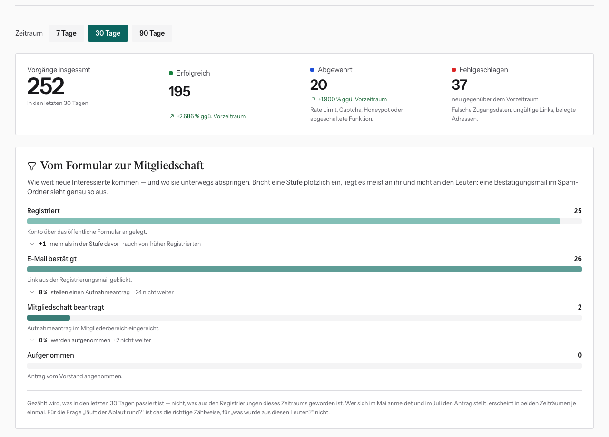

# Sicherheits-Dashboard lesen

Dashboard → Debug-Modus an → **Sicherheit** (`/dashboard/security`).
Die Seite zeigt Logins, Registrierungen, Kontaktanfragen und
Passwort-Zurücksetzungen im Zeitverlauf.

## Von oben nach unten

- **Zeitraum**: 7, 30 oder 90 Tage.
- **Kacheln**: Vorgänge insgesamt, **Erfolgreich**, **Abgewehrt** (Rate Limit,
  Captcha, Honeypot, abgeschaltete Funktion) und **Fehlgeschlagen** (falsches
  Passwort, ungültige Links, belegte Adressen), jeweils mit Vergleich zum
  Vorzeitraum.
- **Vom Formular zur Mitgliedschaft**: wie viele sich registrieren, die
  E-Mail bestätigen, einen Antrag stellen und aufgenommen werden. Bricht eine
  Stufe plötzlich ein, liegt es meist an der Technik. Eine Bestätigungsmail
  im Spam-Ordner sieht z. B. genau so aus.
- **Unbestätigte Registrierungen**: wie viele nach 24 Stunden automatisch
  gelöscht wurden und wie viele gerade offen sind.
- **Tagesverlauf**, **Wochenraster** (wann ist was los?), **Nach Vorgangsart**.
- **Versuche und Erfolge im Detail**: Tabelle mit Erfolgsquote je Vorgang.
- **Warum Vorgänge abgewiesen wurden**: die häufigsten Gründe.
- **Letzte Ereignisse**: einzelne Einträge.
- **Rate Limits**: siehe [Rate-Limit-Sperre aufheben](rate-limit-aufheben.md).

## Worauf du achten solltest

- **Viele „Falsche Zugangsdaten“ in kurzer Zeit**: jemand probiert Passwörter
  durch. Die Rate Limits bremsen das automatisch. Hält es an, siehe
  [Notfall](notfall-abschalten.md).
- **Viele Honeypot- oder Captcha-Treffer**: Bots. Ist normal, solange sie
  abgewehrt werden.
- **„E-Mail bestätigt“ bricht ein**: Mails kommen vermutlich nicht an. Prüf den
  Mailversand.

## Was gespeichert wird

Keine Passwörter, keine Nachrichteninhalte, keine Links. E-Mail- und
IP-Adressen nur als nicht rückrechenbares Pseudonym. Pseudonyme und
Browserkennung werden nach 7 Tagen entfernt, ganze Einträge nach 90 Tagen.
Du kannst also nicht herausfinden, *wer* etwas versucht hat. Das ist so gewollt.
